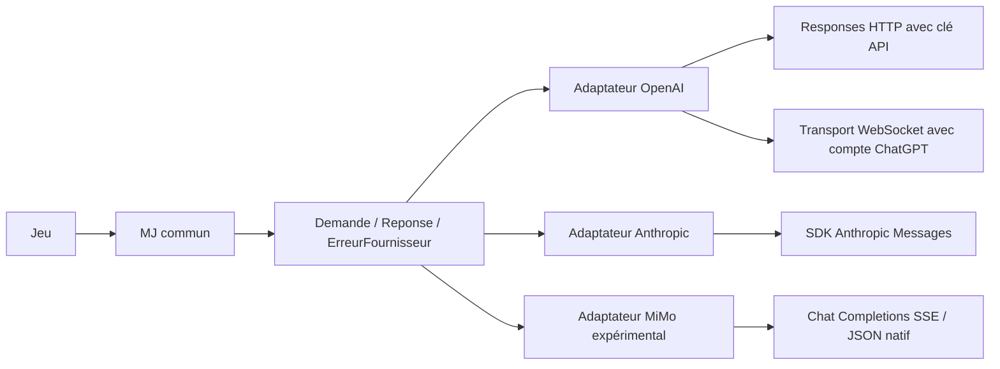

# Séparation du MJ et des fournisseurs

Branche `refactor/adaptateurs-fournisseurs`, issue de `87c1ed5`, préparée sans fusion dans `main`.

Le MJ interprète les intentions et orchestre les propositions, retours moteur, audits, révisions et replis.
Il utilise maintenant un fournisseur indépendant pour chaque appel distant. Les neuf méthodes métier du MJ ont une structure
AST identique à celle de la base ; seuls sa construction, sa fermeture et le raccord à l'appel distant changent.
Les instructions métier et les schémas du jeu ne changent pas.



## Contrat

[`Demande`](../donjon/fournisseurs/contrat.py) transmet les instructions, l'entrée, l'intention, la fonction et son schéma,
ainsi que les réglages de modèle, effort, délai, cache et réflexion. Les données et le schéma sont copiés avant l'appel.
Un adaptateur ne reçoit ni le MJ, ni le monde, ni le moteur. Il convertit la demande en protocole fournisseur et retourne
une `Reponse(arguments, brut, utilisation, sortie)`.

`ErreurFournisseur` distingue le message affichable des données brutes et de la consommation de l'appel rejeté.
Le MJ conserve les traces avec le même observateur qu'avant. Un échec ne reprend plus par erreur la consommation de l'appel précédent.
Les arguments JSON retournés repassent par les contrôles communs : l'adaptateur ne peut pas exécuter une action.
Ce contrat ne garantit pas à lui seul la vérité des narrations ; les limites sémantiques identifiées dans le banc MiMo restent présentes.

## Répartition

| Fichier | Responsabilité |
|---|---|
| `donjon/mj.py`, classe `MJ` | Orchestration commune, contrôles métier, observateur et usage cumulé |
| `donjon/fournisseurs/contrat.py` | Demande, réponse et erreur communes ; état de l'appel courant |
| `donjon/fournisseurs/__init__.py` | Fabrique pour les modes existants `api`, `chatgpt`, `anthropic` |
| `donjon/fournisseurs/openai.py` | Payload Responses, authentification, catalogue, décodage et erreurs OpenAI |
| `donjon/transport_openai.py` | Connexion WebSocket, rotation, reconnexion et lecture des événements ; lecteur SSE déplacé ici |
| `donjon/fournisseurs/anthropic.py` | SDK, adaptation des schémas, réflexion, outil imposé ou transcription |
| `donjon/fournisseurs/mimo.py` | JSON natif strict, validation locale, une correction de format au plus et captures complètes |
| `donjon/transport_mimo.py` | Connexion HTTPS Xiaomi, IPv4 locale, lecture SSE et budget de délai |

Chaque MJ possède par défaut son propre adaptateur. Chaque adaptateur possède ses clients et son état : WebSocket et catalogue
pour OpenAI, client SDK et fonctions sans grammaire stricte pour Anthropic. `MJ.fermer()` ferme le fournisseur.
La connexion WebSocket reste réutilisée entre appels et les règles de rotation et reconnexion restent celles du transport existant.

La forme `function_call` de Responses est décodée uniquement par l'adaptateur OpenAI, conformément à la
[documentation officielle OpenAI](https://developers.openai.com/api/docs/guides/function-calling).
Le format natif de chaque fournisseur reste dans les traces, séparé des arguments remis au jeu.

## Compatibilité et essais MiMo

Le jeu construit désormais `MJ`. `MJOpenAI = MJ` reste disponible dans `donjon.mj` pour les imports des bancs existants.
`lire_flux` y reste réexporté pour les anciens outils de diagnostic. L'ancien module interne `donjon.claude` est remplacé
par `donjon.fournisseurs.anthropic`.

Luna reste le choix par défaut et la comparaison reste désactivée. MiMo est disponible par choix explicite
`--connexion mimo`, avec une clé Xiaomi séparée ; voir [l'accès MiMo et son banc](mimo.md).
L'adaptateur reste également accessible par injection pour les bancs :

```python
from donjon.mj import MJ
from donjon.fournisseurs.mimo import MiMo

# cle_xiaomi vient de la configuration locale du banc, jamais d'une clé OpenAI.
mj = MJ('mimo-v2.6-flash', effort='none', fournisseur=MiMo(cle_xiaomi))
try:
    # Le banc peut utiliser mj.echanger(...) ou mj._appeler_brut(...).
    pass
finally:
    mj.fermer()
```

`requirements-mimo.txt` est facultatif. Le transport MiMo valide complètement JSON et schéma, sans remplissage local de champ ;
il rejette les clés dupliquées et les caractères après l'objet. Une réponse complète invalide peut être renvoyée une fois au modèle
avec le diagnostic ; `relances_format=0` désactive cette correction. Une erreur neutre est affichée si elle échoue ; le diagnostic,
la requête sans en-têtes, le flux SSE exact en base64, les événements complets et le message reconstruit restent dans `brut`.
`effort='none'` désactive la réflexion. IPv4 est utilisé par défaut pour Xiaomi seulement ; `ipv4=False` utilise la résolution normale.
Aucune modification globale de la résolution réseau n'est effectuée.

Les anciens worktrees de mesure et leurs captures restent autonomes. Pour reporter leurs outils sur cette branche,
ils doivent injecter `MiMo` au lieu de surcharger la méthode privée supprimée `_appeler_openai` ou remplacer `jeu.MJOpenAI`.
Le nouveau point d'injection du jeu est `jeu.MJ`. Le banc migré `tools/valider_mimo_parties.py` utilise ce point et le fournisseur
du jeu. Les vérifications initiales du refactor ci-dessous sont conservées ; [la finition MiMo](mimo.md) ajoute deux essais réels.

## Vérification

- Référence avant refactor : 975 tests passent.
- Après refactor : 984 tests passent, avec les dépendances facultatives Anthropic et MiMo ; les 79 contrôles ciblés repassent après le dernier ajustement des traces.
- Comparaison sans réseau de 16 variantes OpenAI et Anthropic : les requêtes produites avant et après sont identiques,
  y compris les variantes HTTP/WebSocket et la transcription Anthropic.
- Neuf méthodes métier du MJ inchangées par comparaison AST.
- Parcours complets sur deux scènes pour OpenAI HTTP, Anthropic et MiMo : une seule exécution moteur, narration sauvegardée
  avant affichage, objet présent dans l'inventaire après reprise et état inchangé après rechargement.
- Parcours WebSocket existants conservés, y compris coupures, fragments rejetés et reconnexion.
- Deux réponses MiMo réellement capturées et rejetées sont rejouées dans le jeu : rejet conservé, diagnostic séparé,
  mêmes octets SSE, monde inchangé, affichage neutre et reprise vérifiée.
- Les 112 réponses capturées de la campagne MiMo sont également rejouées dans le nouvel adaptateur : requêtes et arguments
  acceptés identiques, 106 acceptations et les mêmes six rejets. Ce rejeu vérifie le protocole, sans refaire la campagne moteur.
- Les quatre scripts de parties existants terminent aussi leur prévol hors ligne : 90 saisies, zéro appel et aucun échec de rechargement.

La suite complète après refactor et les contrôles ciblés sont consignés dans le [compte rendu de vérification](verification-fournisseurs/resultats.json).
Les [16 comparaisons de requêtes](verification-fournisseurs/equivalence.json) et les [112 décisions MiMo](verification-fournisseurs/rejeu-mimo-112.json) sont conservées séparément.
Les réponses des parcours sont simulées ou rejouées ; aucun appel réel à un fournisseur n'est nécessaire pour ces vérifications.

```powershell
python -m unittest discover -s tests
python -m unittest tests.test_fournisseurs tests.test_fournisseurs_jeu
```

Les vérifications MiMo nécessitent les dépendances facultatives de `requirements-mimo.txt`, celles d'Anthropic le SDK existant.
