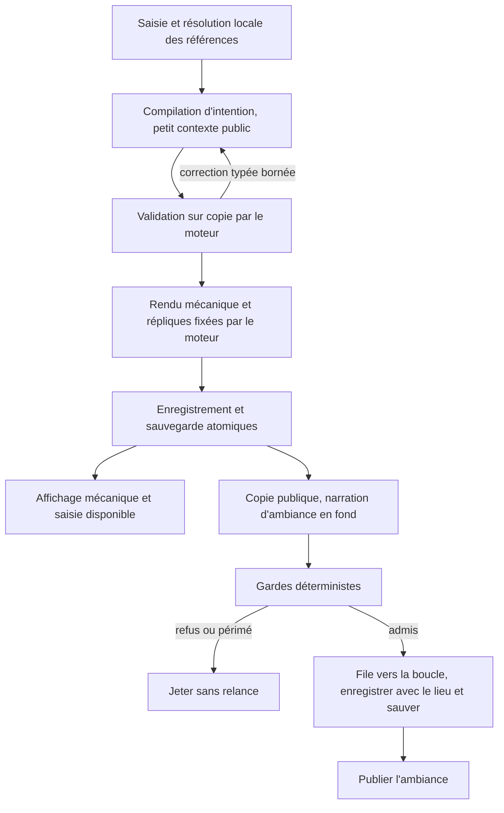

# Refonte du MJ — achever et porter `prompt-simplifie`

29 octobre 2026 — lot de conception 287, **non fusionné**, base d'intégration
`a3666ee`. Document soumis à décision ; aucun changement du contrat ni du jeu
n'est appliqué par ce lot. Il intègre la précision de l'utilisateur :
**`origin/prompt-simplifie` est la base de la refonte**, pas une architecture
concurrente à évaluer. Référence lue : `3c0dcd0`, base commune `c870c8b`.
La seconde précision de l'utilisateur fixe le critère de décision :
**gameplay d'abord**, dans l'ordre interprétation des intentions, vitesse
perçue, invention à la volée, richesse des interactions PNJ. La qualité
littéraire n'est pas un objectif de la refonte.

## 1. Direction et décisions nécessaires

**Révision du 29 octobre, lot 288 :** les décisions désormais acquises,
notamment le récapitulatif joueur (option c avec b en filet), et le nouvel
ordre des lots sont dans [Valeur du LLM](conception-valeur-llm.md), sections
1 et 7. Sa section 8 remplace la liste des questions encore ouvertes de la
section 10 ci-dessous. Les choix historiques du présent document ne sont
donc plus tous en attente. Aucun changement du contrat du jeu n'est appliqué
par ces documents de conception.

Achever le compilateur d'intention à petit contexte, `MJ._echanger_decouple`,
le narrateur d'ambiance en fond, ses gardes déterministes et le fournisseur
local unifié. Le moteur écrit toutes les informations mécaniques. Une
ambiance rejetée est jetée entière, sans seconde génération ni récupération de
segments. L'affichage mécanique, les commandes et la sauvegarde n'attendent
jamais cette ambiance.

Deux frontières demandent une décision explicite : la prose cosmétique libre
ne peut pas recevoir une garantie sémantique universelle de gardes lexicaux ;
un compilateur unique peut produire un plan valide mais infidèle à la saisie.
La refonte supprime les audits de reformulation du mécanique ; elle ne doit
pas prétendre avoir résolu ces deux autres problèmes. Les questions numérotées
de la section 10 et la proposition de contrat de la section 7 rendent ces
arbitrages concrets.

Un refus ou « précise… » n'est pas une réussite de sûreté si l'intention était
exprimable et fidèle au contrat. Le compilateur doit garder cette intention,
ses objets, son prix et ses étapes, et le moteur l'exécuter dès qu'elle est
admise. Une phrase sobre du moteur suffit à montrer l'effet ; toute génération
qui retarde cet effet doit protéger une propriété de jeu identifiée.

Le portage est progressif, famille après famille, avec le moteur actuel comme
autorité. Il ne consiste ni à fusionner les vingt commits en bloc, ni à
réécrire les contrôles du monde, ni à réactiver la comparaison de modèles.
Luna reste le MJ, `gpt-6-luna` sur le forfait ChatGPT ; le local conserve le
même contrat de jeu.

## 2. Ce que coûtent les voies actuelles

### Corpus et méthode reproductible

Lecture seule de 136 parties : 68 de `c9459ce`, dans
`C:/Users/msics/donjon/artifacts/bancs-multi/20261028-235223-6688/integ-r{1,2}/`,
et 68 de `d85fb54`, dans
`C:/Users/msics/donjon/artifacts/verif-luna-d85fb54/20261027-210320-14940/integ-r{1,2}/`.
Ce sont les 34 scripts du lot 165, deux passes par version. Pas de replay,
d'import du moteur, de modèle ni de banc. Un processus Python léger à la fois.

Les scripts et résultats sont exclusivement dans
`C:/Users/msics/donjon/artifacts/refonte-287/` : `compter.py`, `classer.py`,
`mesures.json`, `refus-a-classer.json`, `classement.json`,
`preuves-qualitatives.json`, `sources-sha256.json`. Les 136 empreintes SHA-256
sont identiques avant et après le comptage. Le classement est humain, par
cause principale ; il n'utilise pas un modèle pour juger les refus.

Un tour MJ est une saisie avec au moins un appel ; `quitter` est exclu. Les
secondes sont l'attente cumulée des appels, hors calcul et affichage locaux.
La classification reproduit `tools/banc_multi.py:mesurer` : schéma multimode
pour l'interprétation, dialogue seul pour le récit, `controle_narratif` pour
la révision ; `contenu_conforme` distingue fidélité de parole et contre-revue
d'action. Une relance narrative est un événement de contrôle qui redemande
le texte, pas chaque obstacle de cet événement.

| Ensemble, totaux des deux passes | `d85fb54` | `c9459ce` |
|---|---:|---:|
| Saisies hors sortie / tours MJ | 368 / 188 | 368 / 187 |
| Appels / appels par tour MJ | 561 / 2,984 | 561 / 3,000 |
| Attente cumulée / moyenne par tour | 1 968,80 s / 10,47 s | 1 084,78 s / 5,80 s |
| Médiane globale par tour | 9,09 s | 5,17 s |
| Obstacles narratifs / relances narratives | 39 / 33 | 30 / 26 |
| Refus moteur et contre-revue / tours concernés | 44 / 32 | 48 / 31 |
| Tours en repli | 1 | 0 |

Les médianes globales diffèrent légèrement des moyennes de médianes par passe
du résumé d'origine (9,0 et 5,1). Les secondes des deux campagnes ont été
mesurées à des dates/charges différentes : **aucun gain causal de vitesse**
n'est déduit de leur différence. Le corpus récent n'est pas une exécution
de `a3666ee`, ni de `prompt-simplifie`.

| Fonction, `c9459ce` | Appels | Appels/tour | s/tour | Part de l'attente |
|---|---:|---:|---:|---:|
| Interprétation, corrections comprises | 188 | 1,005 | 2,592 | 44,69 % |
| Audit narratif | 162 | 0,866 | 1,535 | 26,47 % |
| Récit après résolution | 93 | 0,497 | 0,742 | 12,79 % |
| Fidélité de parole | 41 | 0,219 | 0,348 | 6,00 % |
| Contre-revue d'action | 51 | 0,273 | 0,334 | 5,77 % |
| Révision narrative | 26 | 0,139 | 0,249 | 4,29 % |
| Portée des ajouts / capacités physiques | 0 / 0 | 0 | 0 | non exercées |

Récit, audit et révision représentent ensemble **281 appels et 43,54 %** de
l'attente ; cette somme est un volume candidat au déplacement/suppression,
pas une prévision de gain. Elle inclut les répliques, qui ne deviennent pas
automatiquement de l'ambiance. Les 188 interprétations comprennent 162
premiers appels et 26 appels supplémentaires dans la même saisie, soit
49,314 s de corrections (0,264 s/tour, 10,17 % du temps d'interprétation).
Certains tours MJ sont un récit d'exécution sans nouvelle interprétation :
le ratio proche de un ne veut pas dire une compilation par chaque tour.

### Inventaire de la boucle de l'intégration

| Voie et fonctions | Rôle actuel, garantie et limite | Sort dans le portage |
|---|---|---|
| Commandes locales, noms, `paroles.prevue` | Sans appel ; désignations, adresse, portée, mots directs ; syntaxe libre incomplète | Conserver comme entrée commune du compilateur |
| `MJ._echanger` → `_appeler`, `repondre_au_joueur` | Interprète une intention et choisit action, parole, fait ou dialogue ; le moteur revalide | Remplacer par `compilateur.compiler` et son contexte public compact |
| `_echanger_prepare`, retour de forme/validation | Corrections sur copie avec `attendu` ; trois propositions au plus avec correction de forme distincte | Porter la boucle bornée de `_echanger_decouple`, sans narration d'explication |
| `_auditer_action`, `couverture_action` | Compare saisie et plan ; peut détecter une omission malgré un plan exécutable ; sémantique | Exception transitoire ciblée à justifier, voir section 6 |
| `_verifier_fidelite_parole` | Compare mots, opérations, quantités ; mêmes mots n'impliquent pas les mêmes actes typés | Même réserve ; garder les contrôles déterministes d'opérations |
| `raconter_resultat`, appel final après parole/faits | Reformule ce que le moteur a décidé ; fixe aussi aujourd'hui des mots de PNJ | Rendu moteur ; PNJ traités séparément en section 5 |
| `_appeler`, `auditer_narration` | Reprises exactes prouvées localement ; reste classé par Luna ; relecture déterministe du rapport | Supprimer sur le mécanique désormais produit par construction |
| `auditer_portee`, `portee_narrative` | Empêche description/ajout de cacher indice, usage ou perception non exécutée ; reconnaissance sémantique | Aucun rôle en ambiance ; réserver aux créations interactives non couvertes |
| `auditer_capacites`, `coherence_physique` | Compatibilité d'une qualification nouvelle avec matière/description, après bornes moteur | Réserve ciblée sur invention physique, pas sur tout tour |
| Révision, `controle_narratif` | Deux réécritures au plus après refus de prose ; audit illisible redemandé une fois | Zéro pour l'ambiance ; inutile pour phrases moteur |
| Explication après propositions invalides | Appel de dialogue, puis audit ; si refus du monde, un essai avant message moteur exact | Supprimer ; afficher directement le message public du moteur |
| `_repli`, `rescapes`, `narration.repli` | Sans génération propre : comptes obligatoires, rappels/perception, segments admis, moteur | Conserver le résultat moteur ; pas de repli cosmétique à générer |
| `consigner`, transactions, `jeu.py` | Revalide parole, perception, noms et rapport ; sauvegarde avant affichage | Garder ce principe ; remplacer la dépendance obligatoire à `_audit` par une provenance moteur ou ambiance explicite |

Les explications ne sont pas une fonction fournisseur autonome : leurs appels
sont classés interprétation ou révision dans les chiffres. Les replis ne sont
pas une septième fonction modèle. Les compter une seconde fois gonflerait le
coût. Les exceptions de préparation de l'espace et de qualification existent
hors de ces six fonctions observées ; zéro appel observé ne signifie pas coût
nul dans une partie qui les exerce.

### Coût de chaque appel sur les quatre axes du gameplay

I = interprétation/exécution fidèle ; V = vitesse avant effet visible ;
D = invention d'un détail manquant ; P = interactions PNJ. Les temps sont
ceux du tableau précédent, **pas quatre coûts à additionner**. Les effets
qualitatifs ci-dessous sont des mécanismes et des risques, pas des gains mesurés.

| Appel ou voie | I : compréhension du premier coup | V : effet visible | D : détail manquant | P : interactions | Ce qu'il protège, et choix |
|---|---|---|---|---|---|
| Compilation/interprétation (2,592 s/tour avec reprises) | Nécessaire à la saisie libre ; erreur de cible, type ou étape bloque une intention exprimable | Seule attente nominale utile avant validation | Peut proposer fait et action dans le même paquet | Type demande, avis, marché, mission ; éviter le défaut `propos` | Compréhension proposée, jamais preuve de vérité ; porter le compilateur en premier |
| Correction de compilation (0,264 s/tour, incluse ci-dessus) | Récupère une proposition mal formée sans redemander ses mots au joueur ; peut boucler ou abandonner | Ajoute une attente, utile si elle débloque la même intention | Complète une qualification indispensable | Récupère quantité, prix, opération ; ne doit pas effacer l'acte pour réussir | Contrat `attendu`, copies et borne ; conserver la correction utile, mesurer ce qu'elle récupère |
| Contre-revue d'action (0,334 s/tour) | Peut sauver une omission ; peut aussi refuser l'enfermement que son dossier établit | Ajoute un aller-retour avant effet | Peut empêcher de remplacer une recherche par un ajout | Couvre notamment enfermement, protection, gestes composés | Fidélité saisie→plan, absente des seules validations ; limiter aux trous de couverture identifiés, retirer dès contrat déterministe suffisant |
| Fidélité de parole (0,348 s/tour) | Détecte un acte omis malgré des mots exacts ; faux refus possibles | Attente avant toute réponse/transaction | Empêche une déclaration d'être prise pour une création ou une découverte | Protège prix, bien, avis, nom, négociation ; ne doit pas stériliser la parole | Couverture d'opérations, pas style ; maintien résiduel justifié par acte, jamais automatique parce qu'un PNJ est présent |
| Récit après résultat (0,742 s/tour) | N'améliore plus la saisie déjà validée | Retarde aujourd'hui la lecture de l'effet déjà acquis | N'a aucune autorité pour matérialiser | Peut formuler une réponse mais inventer geste/engagement | Aucun besoin pour faits déjà rendus ; supprimer le récit mécanique, garder le contenu social avant sa mise en mots |
| Audit narratif (1,535 s/tour) | Ne répare pas un mauvais plan ; ses faux refus peuvent donner « précise »/repli | Coût principal évitable d'après-validation | Évite certaines créations implicites, sans les valider | Peut protéger une réplique, mais aussi supprimer une réponse correcte | Inutile sur phrases moteur ; gardes du prototype pour ambiance, contrat PNJ distinct |
| Révision et redemande d'audit (révisions : 0,249 s/tour) | Retouche les mots, pas l'intention ; peut en perdre une partie | Chaîne d'attente dépendante | Aucun nouvel objet admis par cette réécriture | Peut effacer prix, rappel ou promesse pour passer le contrôle | Supprimer sur ambiance/mécanique rendu ; ne pas confondre avec correction de compilation utile |
| Explication libre de refus (incluse dans interprétation/révision) | Peut transformer un défaut de proposition en impossibilité prétendue | Ajoute texte puis audit avant le message | Peut annoncer à tort qu'un détail est impossible à inventer | Peut laisser croire à un refus personnel que le PNJ n'a pas donné | Message moteur public suffit ; supprimer cet appel sans supprimer les possibilités du jeu |
| Audit de portée des ajouts (0 observé) | Protège recherche/perception demandée contre substitution | Un appel conditionnel peut retarder l'invention utile | Évite indice ou capacité cachés dans la prose ; ne crée rien | Évite connaissance ou preuve inventée envers un PNJ | Déplacer au point d'admission typée ; ne conserver que ce que type/budget/provenance ne suffisent pas à contrôler |
| Audit de capacité (0 observé) | Évite une action apparemment réussie fondée sur une physique incohérente | Délai conditionnel à mesurer sur fabrication | Protège l'invention compatible, mais peut aussi bloquer une matière encore inconnue | Même contrat pour outil fourni à un PNJ | Validation existante avant toute revue ; conserver seulement le jugement non calculable, sans audit du rendu |
| Complétion initiale d'espace / `compiler_faits` (non isolés ici) | Peut fournir le préalable qui manque à l'action | Doit rendre la main à l'interface ; ne jamais attendre une narration | Fonction de jeu : proposer forme/objet/propriété puis valider | Permet objets/offres/services utilisables par PNJ | Reprendre le chemin du prototype ; mesurer nombre d'appels jusqu'à manipulation, ne pas en faire un habillage obligatoire de chaque lieu |
| Repli local (0 appel propre) | Peut préserver l'acquis ou perdre une intention exprimable ; à classer comme échec de gameplay dans ce dernier cas | Affiche enfin une issue sûre | Ne doit pas supprimer une matérialisation déjà validée | Doit conserver paiement, accord et paroles déjà effectués | Garder les acquis du moteur ; absence de repli ne prouve pas seule une bonne interprétation |

La priorité à la vitesse ne justifie pas de supprimer une possibilité de
jeu pour obtenir un appel de moins. À l'inverse, une revue qui ne protège
plus rien après typage/rendu ne reste pas pour conserver un compteur de
refus historique. Récit et audit de l'ambiance n'ont aucun rôle dans la
compréhension ou l'invention nécessaire à l'action.

### Familles de refus, utiles, faux et indécidables

Les **30 obstacles narratifs** récents sont tous classés ci-dessous. Deux
occurrences lexicales identiques dans le même contrôle restent deux obstacles.
Le coût en secondes par famille n'est pas isolé par les archives : un appel
peut porter plusieurs assertions. Aucun temps causal par famille n'est inventé.

| Cause principale | Nombre | Exemples dans `classement.json` (indices du fichier source) |
|---|---:|---|
| Positions, repères et souvenirs | 6 | 97, 102, 107, 132, 138, 139 |
| Perception, absence, conseil | 5 | 82, 83, 94, 123, 129 |
| Paroles actuelles et rappels | 5 | 86, 87 (deux obstacles), 110, 130 |
| Signes, attitudes, gestes | 4 | 85, 96, 106, 145 |
| Explication de refus et non-exécution | 3 | 92, 127, 135 |
| Comptes | 2 | 88, 108 |
| Lexique d'entités | 2 | 89, doublon conservé |
| Perception et non-exécution dans un même contrôle | 2 | 122, deux segments |
| Lumière | 1 | 103 |

Les familles perception/positions représentent ainsi 13/30 obstacles, cas
mixte compris ; elles passent en tête du travail après adoption du contrat.
Les comptes ont déjà leurs phrases moteur mais le narrateur les réécrit
encore, ce qui déclenche deux gardes : le raccord doit interdire cette double
autorité dès la construction de la réponse.

Les **48 refus de validation** se répartissent en portée 11, dimensions ou
matériel d'un passage 11, écoute (forme/fidélité) 4, `impossible` prématuré 4,
désignation 3, enfermement/fidélité 3, limites ou fidélité de violence 3,
typage/sens de parole 3, ressource omise 2, propriété inconnue 2,
perception contre invention 2. Ce sont des occurrences, pas 48 intentions
impossibles : certaines corrigent une proposition, d'autres se répètent.

Échantillons confrontés aux données reçues, tours indexés à partir de zéro :

- **Refus utiles** : `soir-noir` p1 t5 (110) invente « je t'ai déjà dit que
  je ne voulais pas te dire qui je suis », absent des quatre paroles passées ;
  `echanges` p1 t3 (96) ajoute un hochement sans signe ; les passages trop bas
  et l'outil trop encombrant ont des valeurs et bornes explicites dans
  `attendu`. Les deux refus de comptes récents appliquent bien le partage
  d'autorité du lot 180, même si le transfert raconté est correct.
- **Faux refus établis** : `force-4f-enfermer` p1 t0 (98) refuse un plan tout
  en disant qu'il accomplit l'enfermement ; le dossier de l'étape verrouiller
  contient Bram dans `personnes_retenues_apres_operation`. `noms-dialogue`
  p2 t1 (138) nie la proximité d'Aubin alors que sa localisation publique
  est à 1 mètre au sud et `a_portee_de_main=true`. Ce sont deux familles
  différentes : fidélité de l'intention, puis description d'une position.
- **Sources contradictoires, pas de verdict simpliste** : `avis-joueur` p1
  t1 (86/87), `issue` et `repondent=[marchand]` disent qu'Aubin et Ilse se
  taisent, mais `conversation_validee.faits` contient leurs deux répliques.
  L'auditeur refuse le silence, puis la garde refuse de leur donner la parole.
  Il faut un flux typé unique des émissions réellement entendues, distinguant
  réponse à Corvus et dispute entre PNJ ; enlever l'audit seul ne tranche rien.
- **À ne pas déclarer faux sans preuve supplémentaire** : le corps de Brune
  (132) n'a pas de localisation dans le petit dossier du récit ; les limites
  de visibilité derrière la porte (94/129) et l'ambiguïté de « elle » dans
  le souvenir (102) demandent un examen de portée. Pas de taux global de
  « justesse » calculé depuis le seul motif de l'auditeur.

Le lot 171 apporte trois faux refus historiques supplémentaires prouvés dans
son [rapport](taches/rapport-codex-171-mesures-resolues.md) : deux pas résolus,
destination de fuite et coordonnées 2 m nord/3 m ouest. Ses bruts et ceux du
lot 168 ne sont pas présents sous leurs chemins annoncés sur ce laptop : ce
document cite leur diagnostic publié, sans prétendre les avoir recomptés.

### Lecture des mesures antérieures

| Source lue | Apport à la conception |
|---|---|
| [93](taches/rapport-codex-93-latence-par-appel.md) | Audit 41,1 %, interprétation 36,8 % sur six scripts ; latence vient des contrôles, pas seulement des jetons |
| [95](taches/rapport-codex-95-audit-narratif.md) | Sortie d'audit −36,3 %, appels 3,218→3,256/tour ; preuve exacte déjà disponible, extraction libre toujours sémantique |
| [116](taches/rapport-codex-116-rapports-illisibles.md) | 18→0 audits illisibles sur le banc, sans gain de délai global ; cohérence d'un rapport n'est pas sa justesse |
| [141](taches/rapport-codex-141-verif-luna.md) | Comptes, chronologie, avis et explications techniques ; limites des projections rechargées |
| [153](taches/rapport-codex-153-verif-luna.md) | 3,01 appels/tour, avis 3/6, traîner/enfermer encore bloqués ; corriger l'entrée reste nécessaire |
| [162, branche non fusionnée](https://github.com/msicsic/jdr/blob/fd90d59/docs/taches/rapport-codex-162-audit-invariant.md) | Schéma invariant, mais relances 13→22 et trois pertes de refus au-delà du seuil ; ne pas porter ce schéma |
| [165](taches/rapport-codex-165-verif-luna.md) | 3,21 appels/tour ; avis 6/6 mais faux refus de mesures et de comptes |
| 168, [brief](taches/codex-168-relances.md), état de développement | Attribution demandée ; essai abandonné d'après le contrat, pas une correction à récupérer |
| [170, branche non fusionnée](https://github.com/msicsic/jdr/blob/b503242/docs/taches/rapport-codex-170-consignes-degraissees.md) | −2,7 % de consignes, 3,24→3,30 appels/tour, relances 14→19 ; réduire le rôle plutôt que gratter le prompt monolithique |
| [171](taches/rapport-codex-171-mesures-resolues.md) | Les données nécessaires étaient déjà présentes ; faire écrire les mesures au moteur |
| [176, branche non fusionnée](https://github.com/msicsic/jdr/blob/7fb17a4/docs/taches/rapport-codex-176-banc-attitudes.md), état de développement | Appuis typés utiles, extraction sémantique non exhaustive ; 3,19 contre 2,94 appels/tour après élargissement de l'audit |
| [180 c](taches/rapport-codex-180-comptes-ecrits-moteur.md) | Modèle à étendre : moteur rédacteur des comptes, pas de réextraction par auditeur |
| [216](taches/rapport-codex-216-verif-luna.md) et c9459ce | Les audits coûtent encore après ces progrès ; les compteurs seuls ne certifient pas les textes |

Les liens vers les rapports de branches servent à leur localisation ; ils ont
été lus par `git show`, sans navigation ni nouvelle mesure. Les corpus
historiques diffèrent : les pourcentages du 93 et de c9459ce ne se soustraient
pas comme un effet de version.

## 3. Répartition des affirmations : données suffisantes et travail restant

Une phrase appartient au mécanique par ce qu'elle affirme, même si son ton
est littéraire. Le fait qu'un personnage « semble » penser quelque chose ne
transforme pas une lecture de signe en ambiance. Les références ci-dessous
sont les données publiques, jamais une lecture directe des secrets du monde.

| Famille | Classe et donnée qui suffit | Déjà produit par le moteur | À achever dans le chemin découplé |
|---|---|---|---|
| Présence et non-perception | Mécanique : visibles, couverture, auditions, mémoire séparée | `pnj.suivre_presences/bilan_presences`, `rendu.regarder`, attestations et `non_vus_connus` | Employer leurs phrases dans réponses descriptives ; ne pas transformer hors de vue en absence ni dernière position en présence |
| Position, sortie, passage, regard | Mécanique : `localisation.decrire/relatif/orientation_relative`, position perçue ou souvenir daté, sorties connues, état de porte | Repères métriques et relatifs, description et scène perçue | Formateur public unique pour question et résultat ; qualifier le souvenir ; réévaluer le regard, sans dévoiler la salle inexplorée |
| Distances et pas | Mécanique : écarts métriques et liste ordonnée des déplacements réellement résolus | Repères en mètres, lignes « Tu avances d'un pas » | Totaliser par acteur, séquence et unité, pas en additionnant des nombres de prose ; ni déplacement proposé ni son entendu ne compte comme pas du joueur |
| Lumière | Mécanique : `perception.eclairage`, contributions, `effet_percu`, `source_visible`, niveau | `rendu.decrire_perception`, carte de lumière et attestations | Formuler effet reçu et source vue séparément ; ne pas nommer une source cachée ; pas d'audit d'une phrase choisie par le moteur |
| Possession et ressources | Mécanique : portage/contenants accessibles, propriétaire connu, charges/combustible publics, transfert résolu | Fiche, descriptions, journal d'opération | Distinguer porté, appartenant à, offert et livré ; montrer uniquement ce qui est perçu ou connu, pas l'inventaire privé d'un PNJ |
| Comptes et engagements | Mécanique : `comptes.issue/etat/offres`, termes et conditions typés | `comptes_narratifs.phrases/completer` (180), `rendu.decrire_comptes/decrire_accords` | Raccorder chaque sortie découplée et son repli au même formateur ; couverture obligatoire, pas de doublon ni réécriture Luna |
| Résultat, blessure, prise, échec | Mécanique : journal de l'exécution, effets réellement appliqués, perceptions et présences de cette exécution | `narration.rendre_resultat`, résultats du moteur, `Moteur._clore_bilan` | Rendre le résultat sans second récit obligatoire ; séparer plan en attente, effet exécuté et refus avant tentative |
| Refus | Mécanique : type d'erreur, message public, champ reçu et admissible privé | `reponse_du_moteur`, refus de portée sans appel, `ErreurMonde.attendu` | Étendre le message moteur aux autres obstacles ; une erreur de forme donne une correction/clarification, jamais une impossibilité du monde ni un échec subi |
| Signes et attitudes perçus | Mécanique perceptive : `signes.publics`, `impressions`, cible, appui et netteté | Textes de signes, `_impression`, `bilan_signes` (21/3c) | Les rendre directement ; pas d'accès à `emotion` privée ni à un agenda secret. Une impression reste incertaine et dépend de son signe encore perçu |
| Paroles actuelles | Événement mécanique : locuteur réel, référence publique, acte, issue, mots, instant, auditeurs ; vérité du contenu distincte | `paroles.preparer_parole/issue/annonce`, faits d'opérations, paroles déjà écrites par le moteur | Unifier contenu et émission, formater les répliques, enregistrer avant affichage ; voir section 5 |
| Rappels de paroles | Mécanique historique : registre réellement entendu et son ordre | `narration.echanges_passes/rappels_exacts`, `rappel_exact` | Restituer la citation du registre ; aucune nouvelle émission ni paraphrase attestant un faux passé |
| Objet, détail, propriété ajoutés | Interactif : proposition typée, ancrage public, budget, révision, validation des usages | `faits_locaux`, qualifications et transactions | Porter sans court-circuiter les gardes d'indice, de perception active et de capacité ; ciblage de l'ambiance à rétablir |
| Texture, odeur, son de fond, impression du lieu | Cosmétique : texte et lieu d'origine, sans nouvel objet ni information de jeu | `ambiances[lieu]`, génération en fond du prototype | Persistante avant exposition, jetable à la validation ; aucun nouveau répondant, indice, quantité, absence, déplacement, lumière ou attitude d'un PNJ |

Une odeur peut être cosmétique ; « l'odeur prouve un passage récent » crée un
indice et ne l'est plus. Le moteur n'a pas à inventer une position pour sauver
une phrase. Il fournit la phrase justifiée ou dit la limite de la perception.
Un détail ciblable issu de l'ambiance passe par la matérialisation, jamais
par la seule décision du narrateur.

## 4. Ce qui est déjà fait dans `prompt-simplifie`, et son portage

### Divergence mesurée, pas supposée

`git merge-base HEAD origin/prompt-simplifie` donne `c870c8b`. La branche porte
20 commits, 25 fichiers, 4 376 insertions et 51 suppressions depuis cette base.
L'intégration en porte 225, mais seulement 13 fichiers sous `donjon/` changent
au total depuis cette base, principalement les PNJ. **`mj.py`, `narration.py`,
`consignes.py`, `comptes_narratifs.py` et les fournisseurs sont identiques
entre `c870c8b` et `a3666ee`.** Le lot 180, les actes de parole, avis, rappels,
refus et `attendu` étaient donc déjà dans la base rebasée du prototype :
il faut les raccorder à ses nouvelles voies, pas les présenter comme absents
de son ancêtre.

Les changements directs à `paroles.py` sont 6 lignes ajoutées/2 retirées :
`jet_persuasion(..., bonus=0, bilan=None)`. `signes.py` change de 144/52 lignes,
`pnj.py` de 195/26, `agendas.py` de 448/15 ; relations, échanges, délibération
et planification changent également. Le portage doit consommer ces fonctions
actuelles sans restaurer leurs anciennes versions. La page web a 98/4 lignes
de changements propres à l'intégration : son bandeau ne se copie pas en
remplaçant le fichier. Ces nombres sont des différences nettes, pas un audit
fonctionnel des 225 commits.

### Éléments à reprendre et corrections nécessaires

| Élément du prototype | Acquis lu dans le code/tests | Achèvement ou adaptation |
|---|---|---|
| `compilateur.py` (957 lignes) | Schéma des actions et des douze actes, normalisation, `compiler/extraire_contexte`, `compiler_faits` ; `section_contenu` dérivée du contrat | Reprendre les contrats, pas les réparations sémantiques silencieuses ; contexte public filtré et propositions composées complètes |
| Petit contexte | Objets, inventaire, interlocuteurs, noms/lieux connus, comptes, accords, atelier, parole prévue | « ~150 jetons » est un commentaire initial, pas une mesure actuelle : les dossiers l'ont enrichi. Mesurer taille/préfixe ; aucun plafond arbitraire qui retire un fait utile |
| `_echanger_decouple` | Validation sur copie, trois propositions bornées, correction `attendu`, portée locale, parole distincte du geste | Raccorder les formateurs, fidélité résiduelle et tous les retours ; supprimer toute justification libre affichée comme fait |
| `_resoudre_faits_decouple` | Qualification positive/négative, fait enregistré puis reprise de l'intention, atelier | Ne pas dépendre d'une sous-chaîne dans `attendu` pour choisir une opération ; statut typé commun. Réserver les audits nécessaires à l'ajout, pas au récit |
| `narrateur.verifier_narration` | Réemploi de `voix_auteur`, `paroles_sans_moteur`, `voix_inconnues`, `mentions`, chiffres sans fondement | Base des gardes à conserver ; fondement public plus strict, pas de permission dérivée d'une simple présence dans la même salle |
| `narrer` | Appel après résultat, retourne vide sur erreur de transport/validation | Supprimer sa relance et son filtrage par segments ; un seul essai, tout le bloc est jeté au premier échec |
| `repondre_dialogue` | Réplique formulée depuis les faits moteur, noms protégés, secours sur les faits | Encore synchrone dans `_echanger_decouple`, avec possible relance : ce n'est pas l'architecture finale. Remplacer les contenus mécaniques par des phrases moteur |
| Thread et bandeau Narrateur | Copie sous verrou, numéros monotones, réponse vide conservant la dernière ambiance, sauvegarde avant publication, `finally` libérant le bandeau | Un seul propriétaire du monde et une file de résultats ; aucune attente du thread sur une commande ou la sortie, pas de transport partagé bloquant |
| Ambiance persistée | `ambiances[salle]`, 30 entrées, texte borné ; lieu capturé au lancement | `entites=[]` empêche actuellement le ciblage par `ambiance_ciblee` ; rétablir des éléments explicitement enregistrés et validés |
| Local unifié | Ollama `/api/chat` et OpenAI-compatible `/v1/chat/completions` ; `schema_lu` distingue grammaire et descriptions lues | Conserver l'URL explicitement choisie, même pour une fonction découplée ; cache par voie, aucun basculement implicite de fournisseur/modèle |

Les tests `test_proto` couvrent notamment les copies, refus, mots directs,
effets sociaux, qualification, absence de texte interne affiché et recharges.
`test_narration_thread` couvre lieu avant affichage, courses entre résultats,
réponse vide et panne ; `test_schema_compilateur` couvre les variantes d'actes ;
`test_prompt_transport` vérifie que le contrat est lu dans le schéma cloud ou
dans le prompt local. Ce sont des oracles à porter, pas à supprimer en bloc.

L'état de la branche rapporte 12/12 actes correctement compilés par Luna,
**sans exécution**, et des essais locaux. Il rapporte aussi un défaut récurrent
de négociation de mission (`dialogue/propos` au lieu de `conversation_pnj`).
La réussite de ces essais n'est ni une validation de portage ni la preuve de
fidélité de toute saisie. Aucun de ces tests n'a été relancé au lot 287.

À écarter : les changements de mécanique hors périmètre (achat/proximité et
mur mémorisé) comme prérequis de la refonte ; les drapeaux durables donnant
deux contrats de vérité concurrents ; les reprises par comparaison de textes
d'erreur ; les secours qui effacent un acte typé pour faire passer `propos` ;
les justifications libres de `clarifier/impossible` affichées sans provenance.
Une migration peut avoir un sélecteur interne temporaire pour les tests,
mais pas un nouveau mode de jeu qui contourne une garantie.

### Boucle cible, issue de cette architecture

1. **Saisie.** Les commandes déterministes restent sans modèle. Le MJ reçoit
   les références publiques, les mots imposés et les demandes non résolues ;
   désigner un souvenir ne prouve pas que sa cible est accessible.
2. **Compilation.** Une voie bloquante, celle du compilateur. Un appel nominal,
   avec corrections moteur bornées comme dans le prototype ; ni récit ni
   explication libre dans la proposition. Les créations/qualifications font
   partie de la préparation mécanique, pas du narrateur.
3. **Validation.** Préparer sur copie, vérifier révision et préconditions.
   Une séquence, ses faits préalables et son résultat ne publient aucun état
   partiel. Un plan à confirmer reste une proposition ; rien n'est exécuté
   parce que Luna en a écrit le résumé.
4. **Rendu.** Le moteur choisit les phrases depuis les données de la section 3,
   avec références publiques et ordre des événements. Une sortie descriptive
   est une requête typée au rendu, pas un champ de prose prouvé par une clé.
5. **Sauvegarde puis affichage.** État, mots réellement prononcés, auditeurs,
   résultat public et historique sont validés/sauvés avant publication. Un
   échec de sauvegarde interdit l'affichage comme acquis. Les rendus d'un
   événement historique restent ceux de cet événement, pas ceux d'un monde
   recalculé après coup.
6. **Fond.** Donner au narrateur une copie immuable de la projection publique
   et les seules ambiances admises du lieu. Le monde complet peut servir aux
   gardes locaux, jamais être envoyé au fournisseur. Le thread ne modifie ni
   le monde ni l'historique de conversation.

Un résultat cosmétique porte au minimum session, numéro, révision/instant
d'origine, lieu, texte et éléments d'ambiance. La boucle seule l'intègre.
Elle refait les gardes sur ce qui est encore publiable, vérifie session et
lieu courant ; si la révision mécanique a changé, le résultat de cette copie
est jeté même dans le même lieu. Une écriture d'ambiance seule ne constitue
pas un nouveau tour mécanique. Elle enregistre ensuite l'origine et la révision d'enregistrement,
sauve et publie. Une réponse d'un lieu quitté est jetée ; les ambiances déjà
admises de ce lieu restent consultables au retour. Une réponse plus ancienne
qu'une ambiance déjà montrée ne l'écrase pas. Une ambiance vide ou refusée
ne fait pas disparaître la dernière ambiance admise, affichée avec son lieu.

Une seule tâche active et au plus une demande récente en attente évitent
une file de threads. Le tour suivant ne joint jamais le thread précédent ;
`quitter` sauve sans l'attendre. Une génération devenue inutile peut être
abandonnée sans publier. Les instances de fournisseur/transport et leurs
compteurs sont distincts : un verrou WebSocket commun qui ferait attendre
la compilation derrière l'ambiance violerait le découplage.

Les gardes sont ceux de `narrateur.py`, renforcés par le contrat de canal :
pas de parole nouvelle, de présentation nominale, de résultat, d'entité privée
nommée, de compte, de nombre mécanique non établi ni d'affirmation attribuant
une attitude à un PNJ. Leurs reconnaisseurs restent bornés : « tout s'éteint »
peut contredire la lumière sans chiffre ni nom. La séparation de canaux n'est
pas une preuve sémantique de cette prose. Aucun audit modèle n'est lancé en
secours ; voir décision 1.

Le ciblage d'une ambiance ne dépend plus d'une extraction oubliée : l'enveloppe
propose des éléments avec identifiants locaux, libellé et ancrage dans le lieu.
Le moteur valide cette forme et leur sauvegarde avant publication. À la saisie
suivante, un élément ciblé est résolu par la même voie de faits typés, ou dit
non manipulable ; les budgets d'invention et capacités restent communs. La
détection d'un élément implicite ou d'une paraphrase est une limite sémantique,
pas une permission de créer arbitrairement un objet au ramassage.

**Invention sans blocage narratif.** Le compilateur peut soumettre dans un
même paquet ordonné le détail manquant et le geste qui le cible ; le moteur
valide l'ancrage, le budget et les usages, matérialise puis prépare le geste.
S'il faut `compiler_faits` après une propriété manquante, l'interface reste
utilisable, la saisie initiale est conservée et reprise automatiquement après
validation, sans imposer au joueur de redire sa demande. Ce travail ne dépend
ni d'une ambiance reçue ni de son audit. Un rejet n'enregistre aucun objet
partiel. Une autre action effectuée pendant la préparation impose de revalider
les préconditions sur le monde courant ; aucun ancien plan n'est appliqué.
Il existe une dépendance nécessaire : manipuler l'objet attend sa création
validée. « Sans bloquer » garantit ici la disponibilité de l'interface et
l'absence d'attente cosmétique ; zéro attente totale pour toute propriété
inconnue n'est pas démontré. Le mesurer explicitement évite de masquer une
régression sous une simple animation de chargement.

## 5. Répliques des PNJ : le contenu n'est pas du vernis

Le moteur fixe l'acte et son issue : répondre/refuser, nom revendiqué,
localisation crue, ressource déclarée, jugement sur l'eau, paiement, prêt,
marché, mission. La vérité du monde, la croyance du locuteur et ce qu'il
affirme sont trois valeurs distinctes. Un menteur peut parler ; sa déclaration
n'ajoute pas le fait déclaré au monde. Un engagement exige son opération
typée avant que ses mots le promettent.

Le rapport commun doit identifier chaque émission, son auteur, son acte,
ses paramètres, sa modalité (croyance/refus/offre/constat), les événements
mécaniques qui l'autorisent et ses auditeurs. Les réactions de PNJ entre eux
et la réponse à Corvus ont chacune leurs émissions, dans un seul ordre.
Il ne faut plus déduire qui a parlé de listes de phrases et d'un booléen
« répond à Corvus » contradictoires. Les textes existants des opérations
peuvent être conservés pendant cette structuration ; aucune mécanique
sociale n'est à réinventer.

| Option | Formulation et contrôle restant | Effet sur la boucle |
|---|---|---|
| **A — formulation moteur du sens typé (recommandée)** | Formateurs français et variantes de voix choisies déterministement, depuis les seules données autorisées ; mots historiques exacts pour un rappel. Validation des noms, auditeurs, opérations et engagements avant écriture | Pas d'appel PNJ supplémentaire ; phrases parfois moins variées ; pas de paraphrase sémantique à auditer |
| B — Luna reformule l'issue, comme `repondre_dialogue` aujourd'hui | Contrôler omissions, négation, personnes, temps, conditions, quantités, noms et nouveaux engagements. Les gardes actuels ne prouvent pas l'équivalence de tout français libre ; il faut une revue sémantique résiduelle ou accepter cette perte | Appel supplémentaire bloquant avant les mots, ou parole différée comme nouvel événement ; ne satisfait pas la boucle cible sans exception |

A porte d'abord identité, localisation, ressources, comptes et avis : le
moteur sait déjà leur contenu. Les manières de parler existantes autorisent
des variantes de forme sans créer hochement, sourire ou émotion. Une parole
banale peut garder une réponse du répertoire d'un personnage, mais une
question sans contenu couvert reçoit une limite/clarification honnête ;
le compilateur ne fabrique pas une réponse mécanique libre.

Pour une conversation ouverte au-delà de ces actes, l'écart avec l'intégration
doit être décidé : A réduit l'improvisation verbale ; B la conserve avec un
contrôle résiduel et un coût. **Une réplique n'est jamais ajoutée tardivement
par le seul narrateur d'ambiance.** Elle serait un nouvel événement entendu,
avec effets de noms, de mémoire et éventuellement de croyance, donc une autre
transaction mécanique. Remplacer après coup une citation déjà entendue ou
afficher deux formulations contradictoires serait une falsification du passé.

Sur les axes gameplay : A ne doit retirer aucune demande, proposition,
négociation, transmission d'avis ni réaction déjà exprimable ; la sobriété
des mots est acceptable, leur absence d'effet ne l'est pas. B n'est justifiée
que si elle ouvre une interaction utile que les actes/conséquences existants
ne couvrent pas, pas pour améliorer le style. Tester explicitement la
négociation de mission du prototype et une proposition de service évite de
faire passer une baisse de richesse pour une optimisation de narration.

## 6. Sort des audits et des lots versés dans la refonte

Un contrôle n'est conservé que pour une garantie que le découplage ne fournit
pas. Le statut ci-dessous distingue cible et transition ; il ne demande pas
la fusion des branches d'essai.

| Contrôle ou lot | Décision proposée | Garantie résiduelle justifiant un maintien |
|---|---|---|
| Audit narratif du mécanique | **Supprimé** dès qu'une famille est rendue par le moteur | Aucune sur une phrase construite depuis l'état ; conserver ses tests comme contre-épreuves du rendu |
| Audit sémantique de l'ambiance, révisions et sauvetage de segments | **Supprimés** ; gardes déterministes, rejet entier | Changement de garantie à décider explicitement (section 7), pas une garantie équivalente |
| Explications de refus | **Remplacées par le message moteur**, étendu si une cause manque de texte public | Refus de forme et `attendu` privés ; aucune nouvelle impossibilité de fiction |
| Contre-revue d'action | **Maintien transitoire ciblé**, puis retrait décidé sur preuve | Le prototype peut exécuter un geste différent/omettre une étape de la saisie malgré un plan valide ; le rendu déterministe ne le détecte pas |
| Fidélité de la parole du joueur | **Maintien transitoire pour les actes à effets**, pas pour chaque phrase moteur | Un `propos` exact peut omettre `avis`, `qui`, marché, etc. La déclaration d'opérations du même compilateur n'est pas une contre-preuve indépendante |
| Portée des ajouts | **Déplacée vers l'unique admission des faits interactifs**, hors ambiance ; maintien seulement si sens non couvert par données typées | Empêcher un indice, une recherche accomplie ou un usage caché dans un ajout apparemment décoratif |
| Cohérence des capacités nouvelles | **Conservée uniquement à la qualification inconnue**, supprimée pour propriétés existantes/validations numériques | Les bornes de masse/puissance ne prouvent pas qu'un outil peut couper telle matière. Le prototype n'apporte pas cette preuve |
| Gardes noms, ouïe, références, provenance et révision | **Conservés** à préparation et publication | Projection publique, présence/audition, identité revendiquée, absence de double effet et état sauvegardé |
| 176, attitudes | **Remplacé par signes/impressions rendus par le moteur** | Reprendre banc/contre-épreuves ; abandonner l'extraction `attitudes` de l'audit commun. Pas de nouvelle consigne d'exemples |
| 170, consignes allégées | **Absorbé par le compilateur du prototype** | Porter la source unique du contrat et `schema_lu`, pas son allègement monolithique de −2,7 % |
| 162, schéma d'audit invariant | **Sans objet pour la narration cible**, branche non portée | Sources/schéma compilateur invariants restent utiles ; aucune généralisation des audits en liste |
| 171, mesures | **Remplacé par rendus canoniques et totaux typés** | Reprendre les trois cas et un autre par nature ; ne pas reconnaître des paraphrases via leurs seuls nombres |
| 166, faits à la demande | **Abandonné**, conformément à la décision utilisateur | Pas d'omission paresseuse de surfaces pour réduire artificiellement le contexte |
| 180, comptes | **Conservé et raccordé** à toutes les sorties découplées | Couverture du résultat et des termes ; les gardes de réplique libre ne restent nécessaires que si B est retenue |

La cible « seul appel bloquant : compilation » est atteignable pour les
mécaniques connues et l'option A. Le maintien transitoire de fidélité et
l'invention de capacités avec revue sont des **exceptions identifiées**,
pas un coût caché dans le narrateur. Pour les retirer entièrement, il faut
soit une spécification typée dont le moteur peut contrôler la couverture,
soit accepter explicitement la perte d'une vérification sémantique indépendante.
Pour une création dont la compatibilité n'est pas calculable, l'autre option
est de garder la propriété inconnue, ce qui réduit l'improvisation. Un score de
confiance ou une seconde analyse dans le même appel ne garantit aucune de
ces propriétés. Le document ne propose pas de nouveau mode pour les esquiver.

## 7. Proposition de contrat — DÉCISION À L'UTILISATEUR

**Texte proposé pour remplacer « Contrat du MJ » dans AGENTS.md et le décliner
dans `docs/contrat-mj.md`, après accord seulement :**

> Luna reste le MJ avec le modèle `gpt-6-luna`. Le moteur garde l'autorité
> sur les positions, la perception, les ressources, les actes de parole,
> les actions et les sauvegardes. La comparaison entre modèles reste désactivée.
>
> Toute information mécanique affichée provient d'un rendu déterministe du
> moteur, sur les seules données perceptibles ou connues de Corvus, ou d'une
> proposition typée admise par le moteur. Les conséquences et les paroles
> effectivement entendues sont enregistrées et sauvegardées avant affichage.
> Une parole établit son émission et son audition, pas la vérité de son contenu.
> Une intention compilée reste une proposition : sa validité ne prouve pas
> à elle seule sa fidélité à toute saisie en langue libre.
>
> Un objet ou détail manipulable existe dans l'état avant manipulation. Un
> élément d'ambiance ciblé est matérialisé par le contrat commun des faits
> interactifs ou déclaré non manipulable ; aucun texte cosmétique n'applique
> directement un effet, une capacité, un indice ou un engagement.
>
> L'ambiance est une prose cosmétique distincte, produite en fond. Elle est
> enregistrée avec son lieu avant affichage et n'est jamais une source de
> vérité mécanique. Les gardes déterministes de noms, références, voix,
> nombres et provenance s'appliquent avant publication ; un échec fait jeter
> la sortie entière, sans relance. Ils ne garantissent pas l'absence de toute
> contradiction implicite dans du français libre. Aucun audit sémantique
> de l'ambiance ne bloque le jeu.
>
> Les contrôles sémantiques résiduels éventuels concernent seulement la
> fidélité d'une intention ou l'admission d'un fait interactif non calculable ;
> ils sont identifiés et mesurés, jamais employés pour reformuler un résultat
> du moteur ni pour sauver une ambiance refusée.

**Ce qui se renforce :** mesures, comptes, résultats, position/perception et
signes ne passent plus par une reformulation puis une validation probabiliste ;
le jeu est jouable pendant la génération ; aucune ambiance rejetée ne cause
de relance ni ne bloque la sauvegarde.

**Ce qui disparaît ou reste limité :** l'audit sémantique tentant de détecter
les contradictions de l'ambiance disparaît. La phrase actuelle « toute
affirmation factuelle du MJ affichée […] compatible » ne serait plus une
promesse générale sur la prose libre. La garantie lexicale sur les noms privés
reste déterministe dans son domaine ; une allusion ou une paraphrase n'est pas
prouvée sûre. Le choix A retire la reformulation libre de contenus PNJ déjà
fixés, avec une perte possible de variété. Retirer les revues de fidélité ou
de qualification serait une autre décision, **non incluse silencieusement**.

Si l'utilisateur exige la compatibilité factuelle de toute phrase sans ce
résidu sémantique, la sortie affichable doit venir d'un langage contrôlé ou
d'un répertoire validé, éventuellement choisi par Luna : les gardes de
`narrateur.py` sur une prose ouverte ne suffisent pas. Cette restriction de
formulation serait un arbitrage sur le narrateur de la même architecture,
pas une raison de revenir à la boucle monolithique.

## 8. Mesures du gameplay

Le tableau de bord suit les quatre axes **dans cet ordre**, avec dénominateurs
constants et état rechargé. Une action légitimement refusée n'est pas comptée
comme réussite manquée ; une intention exprimable bloquée par la compilation
ou une revue l'est. La validité JSON, le nombre de mots et la beauté du texte
ne sont pas des scores de gameplay.

| Axe | Mesures à conserver par intention, puis moyenne et distribution | Bancs et preuves |
|---|---|---|
| **1. Interprétation/exécution** | Parmi les intentions étiquetées exprimables : proportion de propositions fidèles au premier appel, proportion effectivement exécutées sans correction, refus indu, clarification évitable, abandon/repli ; nombre d'appels de correction et part des intentions récupérées. Séparer l'attente volontaire de `tenter`, le refus réel du monde et le défaut du MJ | Actes des bancs `avis-joueur`, `ressources`, `propositions`, `soir-appel`, `soir-noir`, `force-4f-enfermer`, `force-4f-trainer`, `atelier`. Oracles typés : cible, opération, quantité, prix, étapes, parole/action et état final attendu. Ajouter négociation de mission du prototype et paraphrases de mêmes intentions, sans introduire de consigne spéciale |
| **2. Vitesse perçue** | Horodatages saisie→premier rendu mécanique complet visible, validation→affichage, sauvegarde→affichage, saisie disponible pendant le fond ; moyenne, médiane et p95. Appels/secondes bloquants séparés du fond, nombre de résultats retardés par narration, temps de compilation retenu par transport. Pour une proposition à confirmer : mesurer avant proposition puis `tenter`→effet séparément | `relais`, force, `poser-sol-*`, comptes ; console et web avec événements de publication capturés. Test d'un narrateur artificiellement retenu : action suivante et sauvegarde restent possibles. Le temps cumulé d'appel des vieux fils n'est qu'un proxy, pas cette mesure visible |
| **3. Invention à la volée** | Parmi les demandes de détail compatible manquant : proportion matérialisée et geste repris sans répétition du joueur ; appels et secondes jusqu'à première manipulation ; nombre de demandes « précise » et abandons ; nouveaux objets uniques, propositions refusées sans objet résiduel. Disponibilité de l'interface pendant préparation. Compter séparément les demandes réellement non manipulables ou incompatibles | Ajouter un petit banc `invention-ciblee` : objet ordinaire non préexistant, détail sur support, forme nécessaire à un assemblage, propriété physique inconnue ; pour chacun autre lieu/support, budget dépassé et odeur non manipulable. `assemblage`, `materiaux`, `atelier` pour les capacités. Tester état complet, texte et ciblage après recharge ; aucune dépendance à une ambiance réussie |
| **4. Richesse PNJ visible** | Parmi les interactions exprimables : actes conservés et aboutis, offres acceptées/refusées pour raison moteur, biens/services demandés, conséquences perceptibles, nombre de réponses perdues ou remplacées par un silence/repli. Pour un même scénario : réactions, positions et engagements après interaction ; aucun bonus à la longueur ni à une acceptation indue | `ressources`, `echanges`, `comptes`, `propositions`, `avis-joueur`, noms/voix, `attitudes` et mission/service ; demande, contre-offre, refus, avis contraire, passage libéré, dette, travail confié. Le PNJ peut dire non : il faut que ce non et son comportement soient ceux du moteur, pas une invention du récit |

Les traces du présent lot fournissent déjà appels, attentes modèle, refus,
relances, replis et projections de sortie. Elles ne suffisent pas à calculer
le taux de fidélité du premier coup ou toute la richesse : les étiquettes
d'intention et les mondes complets manquent à certains scripts. Le premier
lot d'implémentation doit instrumenter le banc ciblé pour ces mesures et
conserver son état avant/après/recharge ; **aucun taux de gameplay rétrospectif
inventé** n'est publié ici. Pour une commande locale sans appel, l'axe vitesse
reste mesuré ; l'axe compilation est « sans objet », pas une réussite Luna.

Chaque lot compare les mêmes intentions à la référence en cache, puis lit
les deltas de gameplay, pas seulement les appels. Une amélioration de vitesse
ne valide pas la perte d'une demande ou d'une possibilité de création.
Une première proposition fidèle au prix mal rendu ne valide pas le compte ;
une sauvegarde correcte avec un texte trompeur ne valide pas l'expérience.
Les cas non déterministes gardent leurs deux passes historiques pour contexte,
mais la vérification du lot reste une passe ciblée ; pas de nouvelle campagne
générale pour embellir un taux. Les inconnues et exceptions apparaissent à côté
du score. Local et Luna partagent ces oracles de jeu, avec délais publiés
séparément et sans concours de modèles.

## 9. Plan de lots, un invariant et 30 à 45 minutes chacun

Chaque numéro est un lot autonome, à découper avant ouverture si son brief
dépasse le créneau. Pas de gros portage suivi d'une campagne réparatrice.
Les chemins ci-dessous désignent les fichiers susceptibles d'être touchés,
pas l'autorisation de changer leurs mécaniques sans besoin.

**Protocole M commun à chaque lot de jeu :** une passe Luna des seuls scripts
qui l'exercent, sur copies ; référence exacte figée par le superviseur et lue
du cache. `c9459ce` fournit le diagnostic historique, pas une équivalence à une
intégration plus récente. Si une référence manque, le superviseur la calcule
une fois et la range, sans chaque lot rejouant `main`. Compter séparément
appels bloquants et fond, secondes jusqu'au rendu mécanique, secondes
cumulées/ambiance, corrections de compilation, relances narratives, refus par
cause et replis. Donner moyenne/médiane par tour et tours avec zéro appel.
Les secondes du cache sont contextuelles ; seule une mesure sous charge
comparable établit un gain de délai. Pas de comparaison de modèles.

Pour chaque suppression de refus, prouver la garantie par construction ou la
contre-épreuve qui la remplace. Moins de refus n'est pas en soi une régression
quand le moteur n'écrit plus le faux fait. Une revue résiduelle modifiée doit
encore conserver ses causes justes selon le critère 95, sans rejouer des
campagnes générales. Tests ciblés seulement dans chaque lot : saisie réelle
archivée, autre cas de même nature, faux pendant, état complet et texte rendu
après sauvegarde/rechargement. Suite complète et bancs longs groupés par le
superviseur à l'intégration, conformément aux règles actuelles ; aucun banc
PNJ si seule la couche MJ change.

**Ordre de travail :** interprétation et validation d'abord, dont mesure du
premier coup et récupération des intentions ; ensuite suppression des attentes
avant effet (rendus coûteux de perception, positions, pas en tête), producteur
découplé et publication ; puis admission et reprise des détails manquants ;
enfin achèvement des actes et réactions PNJ. Les tests des interactions
existantes restent des garde-fous dès le premier lot. Le fond ne doit pas
retarder l'invention indispensable au jeu. Aucun lot ne vise l'amélioration
littéraire.

| Lot | Invariant, fichiers et tests ciblés | Mesure Luna / critère, en plus de M |
|---|---|---|
| G0 — contrat adopté | Décisions 1 à 5 inscrites ; `AGENTS.md`, `contrat-mj.md`, plans prompt/migration. Aucun code | Lecture seulement, zéro appel ; fixer ce qui reste exceptionnel avant portage |
| G1 — compilateur public | Petit contexte et schéma couvrent le contrat actuel sans fuite ; porter `compilateur.py`, `section_contenu` de `paroles.py`, `sources.py`, mesures ciblées dans `tools/banc_parties.py`. Schéma invariant, noms opaques, deux scènes et douze actes, recharge | Mesure du premier coup et des corrections récupérées ; scripts des actes concernés et négociation de mission. Résoudre le défaut `conversation_pnj` du prototype, taille/préfixe mesurés, un appel nominal de compilation |
| G2 — validation découplée et refus | Toute proposition reste sur copie jusqu'à admission ; porter `_echanger_decouple`, `retour_refus`, `transactions.py`, `refus.py`. Forme invalide/obstacle réel, composée partielle et révision périmée, aucune mutation cachée ; recharge | `relais`, `sous-obstacle-relais`, `sous-obstacle-trop-bas`, `atelier` ; borne de corrections du prototype, zéro appel d'explication, message public exact sans `attendu` |
| G3 — contrat des transports | Même sens transmis par schéma cloud ou prompt local ; `fournisseurs/contrat.py`, `local.py`, `sources.py`, config. Porter tests grammaire/descriptions, URL explicite ; deux scènes/recharge | `gpt-6-luna` ChatGPT inchangé ; une passe ciblée, local seulement si serveur disponible. Cache par voie ; aucun gain local annoncé sans mesure |
| G4 — résultat public | Une exécution a un rendu complet sans appel de reformulation ; `jeu.py`, `narration.py`, sorties de `moteur.py`. Blessure/ligature et autre résultat, lumière/possession, fiche/carte rechargées | `force-4b-assommer`, `force-4f-ligoter`, `poser-sol-relais` ; zéro appel récit/audit après résultat, même effet du monde |
| G5 — perception canonique | Présent, vu, non vu et souvenir ne se confondent pas ; `rendu.py`, `narration.py`, `pnj.bilan_presences`, futurs accès découplés. Tests signes-guet/noir et un absent à l'auberge, recharge | `signes-guet`, `signes-noir`, `luna-restes-ambiance`, `atelier` ; zéro audit/révision pour les seules réponses de perception moteur |
| G6 — repères | Une position publique produit sa phrase sans réinterprétation ; `localisation.py`, `rendu.py`, adaptateur MJ. Cas 171 atelier et Aubin à 1 m, autre orientation/souvenir ; faux repère impossible | `atelier`, `noms-dialogue` ; zéro relance de position, préserver les noms et la mémoire |
| G7 — déplacements résolus | Un cumul porte acteur, unité, intervalle et mouvements réellement exécutés ; résultats du `moteur.py`, `narration.rendre_resultat`. Deux pas 171, autre fuite, son distinct, plan non exécuté ; recharge | `force-4c-fuir` et autre déplacement ; pas de second récit ni audit du total |
| G8 — producteur d'ambiance | Narration sans effet et un seul essai ; porter `narrateur.py` et ses tests de gardes. Panne, faux nombre/nom, parole inventée, bloc mixte entièrement jeté ; aucune mutation du monde | Ambiance sur `relais`/`luna-restes-ambiance` ; au plus un appel de fond par demande admise, zéro audit/révision/repli cosmétique |
| G9 — indépendance des connexions | L'appel cosmétique ne retient jamais le transport du compilateur ; `fournisseurs/openai.py`, `local.py`, cycle de vie dans `mj.py`. Tests simulés de concurrence, timeout/401 et fermeture ; recharge intacte | Une passe ciblée WebSocket ; aucune attente cachée de compilation derrière l'ambiance, statut d'authentification cohérent et compteurs distincts |
| G10 — publication persistante | Aucune ambiance affichée avant sauvegarde avec son lieu ; `jeu.py`, `narration.py`, tests thread. Lieu quitté, sortie tardive, échec de sauvegarde et autre lieu ; recharge | `luna-restes-ambiance` ; zéro blocage du rendu, ambiance affichée toujours retrouvée avec son origine |
| G11 — interfaces non bloquantes | Une tâche lente ne retient ni saisie ni rendu ; bandeau de `jeu.py`, `web/page.html`, `web/pont.py`. Transport retenu par événement contrôlé en test, menu/saisie/quitter ; pas de temporisation fragile | Une passe `relais` ; latence mécanique indépendante du délai artificiel d'ambiance, compteurs fond distincts |
| G12 — portée d'une création | Un ajout interactif ne remplace pas un résultat de perception ; porter le chemin de faits dans `_resoudre_faits_decouple`, `faits_locaux.py`, accès à `portee_narrative`. Indice refusé, recherche de pierre et autre recherche ; recharge | `atelier`, `crypte`, nouveau banc `invention-ciblee` ; revue uniquement à l'admission nécessaire, aucune création/qualification en boucle, pas de fausse réalisation |
| G13 — qualification | Une propriété inconnue est admise avant son emploi, sans écraser l'établi ; `_resoudre_faits_decouple`, `faits_locaux.py`, accès à `coherence_physique`. Coupe réelle/autre matière, refus négatif, propriété déjà établie ; recharge | Scripts ciblés de coupe/fabrication et `invention-ciblee` ; reprise de la saisie sans répétition, appels/secondes jusqu'à manipulation, même refus sur propriété incompatible |
| G14 — ciblage d'ambiance | Un élément ciblé est matérialisé avant manipulation ou déclaré non manipulable ; `narrateur.py`, `narration.py`, `faits_locaux.py`. Détail réel/autre détail, odeur non manipulable ; recharge | Scripts de ciblage d'ambiance ; appels de faits comptés, absence d'objet avant matérialisation puis objet unique après |
| G15 — émissions de parole | Toute parole entendue a une source typée unique distincte de « répond à Corvus » ; `paroles.py`, opérations d'avis, `narration.consigner`. Cas 86/87, autre dispute, écoute distante et inconscient ; monde/rendu rechargés | `avis-joueur`, `echanges` ; supprimer les contradictions `issue/faits`, ne pas multiplier artificiellement les répondants |
| G16 — paroles d'information | Identité, localisation et ressource sont formulées depuis l'issue ; `paroles.py`, `dialogues.py`, formateurs. Voix qui se nomme et autre identité, info crue fausse, refus de ressource ; recharge | `soir-noir`, `ressources`, `noms-dialogue` ; si A, zéro `repondre_dialogue` et zéro audit de leurs répliques |
| G17 — comptes parlés | Mêmes rôles/termes pour les mots et le résultat, avant publication ; `comptes_narratifs.py`, `paroles.py`, `dialogues.py`. Remboursement Gorm et achat, autre dette/offre ; soldes et citations rechargés | `comptes`, `soir-appel` ; zéro réécriture des comptes, aucune opération perdue, zéro repli comptable |
| G18 — avis | Un jugement cru est rendu comme parole, sans devenir vérité du monde ; `paroles.py`, formateurs. Avis de crue et autre lieu, avis contraire, recharge | `avis-joueur` ; pas d'audit de la réponse typée déjà rendue, aucun avis omis |
| G19 — rappels | Un rappel restitue des mots historiques sans nouvelle émission ; `narration.py`, formateurs. Rappel inventé 110, rappel réel et autre locuteur ; recharge | `soir-noir`, `echanges` ; zéro audit des citations historiques exactes, zéro parole ou connaissance créée par un rappel |
| G20 — signes | Une attitude affichée est le texte d'un signe/impression encore perçu ; `signes.py`, `rendu.py`, branche de description MJ. Tests 176 repris, autre PNJ et signe disparu à l'écriture | `signes-ecart`, `signes-guet`, `attitudes` repris ; zéro extraction d'attitude par audit commun, aucun geste/état mental inventé |
| G21 — fermeture de migration | Toute voie publique emprunte le même contrat ; retirer anciens appels récit/audit et drapeaux temporaires de `mj.py`, `jeu.py`. Matrice de couverture de modes, console/web, anciennes sauvegardes, rechargement | Une passe des seuls scripts encore dépendants de l'ancienne voie. Bilan des exceptions de fidélité/création, décision de retrait séparée si nécessaire ; zéro audit cosmétique, pas de retour au monolithique |

Les rendus réemploient leurs fonctions existantes, sans construire un second
moteur. G15 est un prérequis des formateurs PNJ ; le compilateur ne doit pas
supprimer des interactions en attendant leur raccord. Aucune ambiance n'est
publiée avant G10/G11/G9. Les détails nécessaires à une action sont traités
par G12/G13 indépendamment de cette publication cosmétique.
Les tests du prototype ne doivent pas tous être réécrits dans G21 : chaque
lot porte ses oracles pour garder une référence indépendante.

## 10. Risques et questions à l'utilisateur

1. **Ambiance libre sans audit sémantique.** Accepter le contrat de la section 7,
   qui garantit les gardes définis et l'absence d'effets mécaniques, mais pas
   toute contradiction implicite ? **Recommandation : oui**, avec canal distinct,
   facultatif, pas de relance ; ne jamais prétendre conserver la garantie de
   compatibilité universelle. Si cette limite est refusée, restreindre la
   formulation à un répertoire validé dans la même architecture.
2. **Mots des PNJ.** Choisir A pour les contenus déterminés par le moteur ?
   **Recommandation : oui**, puis décider séparément de la conversation ouverte.
   B exige un coût et un contrôle de sens supplémentaires ; l'afficher comme
   simple ambiance ne règle ni la fidélité ni les paroles enregistrées.
3. **Un appel bloquant : voie ou nombre strict ?** Garder les corrections
   bornées `attendu` et la qualification du prototype ? **Recommandation : oui**,
   un appel nominal et seulement des reprises mécaniques justifiées, avec
   compteurs séparés. Exiger strictement un appel total supprime aussi ces
   corrections et peut transformer des intentions exprimables en demandes de
   clarification ; ce n'est pas acquis par le seul découplage.
4. **Fidélité de saisie.** Supprimer immédiatement la contre-revue indépendante
   alors qu'un plan valide peut omettre un acte demandé ? **Recommandation : non**,
   conserver temporairement la revue des actes à effets et des compositions
   non couvertes ; supprimer tout contrôle de reformulation du mécanique.
   Mesurer et décider le retrait résiduel à G21 ; aucune garantie générale
   d'équivalence du langage libre n'est annoncée par ce document.
5. **Invention interactive non calculable.** Garder une revue ciblée de portée
   ou de capacité quand le moteur ne peut pas la déduire ? **Recommandation : oui**,
   uniquement à l'admission de l'ajout. L'autre choix sûr est de laisser la
   propriété inconnue, avec une perte de jeu ; des bornes numériques seules
   ne remplacent pas cette garantie. La cible à un seul appel nominal sur les
   cas connus ne doit pas masquer cette exception.
6. **Concurrence et persistance.** Jeter une ambiance tardive d'un lieu quitté,
   garder la dernière admise et ne pas attendre à la fermeture ?
   **Recommandation : oui**. Une ambiance jamais affichée peut être perdue ;
   toute ambiance affichée reste enregistrée et rattachée à son origine.
7. **Portée de l'adoption.** Porter l'architecture et ses oracles par les lots
   ci-dessus, sans fusion globale de la branche ? **Recommandation : oui**.
   Préserver notamment les signes/PNJ actuels, `jet_persuasion` et les ajouts
   web. La correction de négociation de mission est un critère du portage,
   pas une régression à déclarer acceptable parce qu'elle préexiste au prototype.

Ces décisions ouvrent l'implémentation ; elles ne sont pas déduites d'un accord
pour ce lot de conception. Les mesures montrent où est l'attente actuelle,
pas la performance future. Aucun invariant nouveau du jeu, aucune compatibilité
transport en exécution et aucune absence générale de contradiction ne sont
certifiés par cette lecture documentaire.
